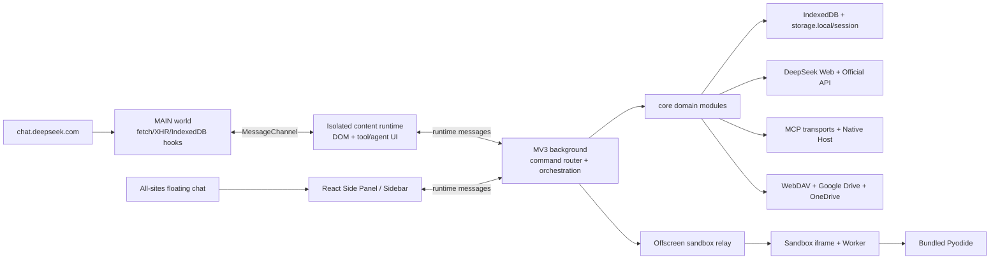

# DeepSeek++ Project Overview

## Preliminary Direction

While preserving existing user data, feature surface, and cross-version contracts, perform a structural refactor of DeepSeek++ to systematically improve the browser extension's performance, stability, compatibility, maintainability, and backward compatibility. The specific scope and priorities will be confirmed in Phase 2 based on this analysis.

## Confirmed Task Definition

On 2026-07-13 the user confirmed this round's task name as **DeepSeek++ Reliability and Compatibility Refactor** and set the following execution boundaries:

1. **Scope**: The main scope covers the PC Chrome/Edge/Firefox extensions, the Shell Native Host, sync, persistence, and automation; Android, mobile WebView, and mobile installation packages are no longer part of the product scope.
2. **Strategy**: Adopt a compatibility-contract-first incremental refactor. First pin historical data and behavior contracts, then fix security/data/cancellation semantics, then establish ports with real consumers and split the large entry points, and finally optimize performance based on measurements.
3. **Compatibility**: Preserve all existing user features, prompt output, storage keys, IndexedDB, sync/MCP/runtime message/Native Host contracts, and Chrome/Edge/Firefox support; any schema change must have an explicit migration, and silently dropping old data is not allowed.
4. **Testing policy**: Building a full E2E, coverage, or performance infrastructure is not an independent project goal; however, any change to behavior, data, security, schema, routing, permission, persistence, or caching must add or update the corresponding automated tests and pass the existing relevant quality gates.
5. **Tracking**: Use `GITHUB_STANDARD` Issues + Milestones + PRs; do not create a Project board. Starting 2026-07-14, Issues serve as the acceptance checklist, and the remaining refactor flows into one batch branch and one final PR through isolated owner lanes. Security-sensitive Issues describe only publicly disclosable goals and acceptance results.
6. **Governance**: `AGENTS.md` is the sole agent instruction truth source. The root `CLAUDE.md` is no longer used; if it exists, still-valid content is first merged into `AGENTS.md` and then it is deleted. The root `CLAUDE.md` no longer exists; `videos/deepseek-pp-promo/CLAUDE.md` was identical to the `AGENTS.md` in the same directory, so the latter was kept and the duplicate file deleted.
7. **Deferred**: Any global coverage number, building a standalone large test platform, and reserved abstractions with no existing consumers.

Scope revision on 2026-07-13: Issue [#345](https://github.com/zhu1090093659/deepseek-pp/issues/345) supersedes the earlier minimal Android compatibility plan, removing the Android template, bridge, build, CI, and test support surfaces. The Android records of T1.5/T2.3 are kept only as historical execution evidence.

## Analysis Snapshot

- Integration branch: `codex/362-background-deepseek-chat-handlers`
- Baseline HEAD: `8fa92228` (R4.2 / #361 merge); the current single-batch integration branch contains R4.3–R6.5, final audit fixes, and gate migration checks
- Date: 2026-07-14
- The current implementation lives in an isolated batch worktree; user changes in the original repository were not overwritten or brought into this branch.
- Current size (excluding `node_modules/`, `dist/`, archives, and generated assets):
  - `core/`: 243 TypeScript/TSX files, about 42,714 lines
  - `entrypoints/`: 108 TypeScript/TSX files, about 30,095 lines
  - `packages/shell-host/native` + `lib`: about 2,878 lines (plus README/package metadata)
  - `tests/`: 182 TypeScript test/fixture source files, of which 161 are test files, about 34,292 lines
  - `scripts/`: 21 scripts, about 3,871 lines

## Current Architecture

DeepSeek++ is a multi-runtime WebExtension system for PC browsers, not a single React page. It includes the MV3 service worker, the DeepSeek page isolated world and MAIN world scripts, the React Side Panel/Sidebar, a site-wide floating chat entry, a browser sandbox, and a Native Messaging Host.

### Runtime Flow

1. `entrypoints/main-world.content.ts` and `entrypoints/content.ts` start at `document_start` and exchange a `MessagePort` through `window.postMessage`.
2. The MAIN world's `core/interceptor/fetch-hook.ts` patches `fetch`, XHR, and some IndexedDB reads to intercept DeepSeek requests/responses.
3. Request augmentation reads memory, Skills, presets, project context, and tool descriptors through the isolated world, then returns the modified request body.
4. Tool XML in streaming responses is parsed in the MAIN world, forwarded through the content runtime to the background, and then dispatched by `core/tool/runtime.ts` to built-in tools, MCP, or browser control.
5. The Side Panel accesses the background through runtime messages; the background is also responsible for automation, sync, conversation export, the official API, permissions, the sandbox, and lifecycle recovery.
6. The sandbox uses `background -> offscreen document -> sandbox iframe -> Worker`, with the Python runtime provided by Pyodide.

## Technology Stack

| Layer | Current | Transformation Position |
|:--|:--|:--|
| Language | TypeScript 5.9 / ESM | Keep; whether to adjust the target is decided by the compatibility contract |
| Extension framework | WXT 0.20, MV3 | Keep, strengthen the platform adaptation boundary |
| UI | React 19, Tailwind CSS 4, React Markdown | Keep, split by feature/controller |
| Local persistence | Chrome storage, Dexie/IndexedDB | Keep key/DB identity, add migration and transaction contracts |
| Tool/runtime | XML tool calls, MCP, browser control, sandbox | Keep user features, converge messaging and execution policy |
| Sandbox | Worker, Sucrase, Pyodide | Keep capabilities, establish size and on-demand loading goals |
| Test | Vitest 4 + jsdom | Keep and add real-browser, migration, and fault-path verification |
| Build/release | npm workspaces, WXT, GitHub Actions | Keep three browsers and the release gate |
| Native integration | Node Native Messaging Host | Keep the protocol, split the monolithic implementation |

## Entry Points

| Entry Point | Responsibility | Current Structural Signal |
|:--|:--|:--|
| `entrypoints/background.ts` + `entrypoints/background/*-handlers.ts` | Service worker bootstrap, single 121-command registry, sync/automation/tool composition, and lifecycle | Root file 1,411 lines; all 121 live commands are typed handlers, 80 payload-bearing commands are decoded at the receiving boundary, and the old switch/router/types have been deleted; auth refresh ignores only an explicitly missing receiver, while other tab delivery errors are visible |
| `entrypoints/content.ts` + `entrypoints/content/` | DeepSeek DOM capability composition, tool cards, inline agent, export, multimodal, theme, pet, token speed, recovery state | The root file is still a 7,417-line hotspot, but an epoch/resource kernel now owns the bridge, navigation, and listener/observer/timer/root/port lifecycle; tool/trace storage moved into strict codecs/stores |
| `entrypoints/main-world.content.ts` + controllers | MAIN world bridge, navigation, and network interceptor assembly | Root file 89 lines; patch/reinjection/BFCache teardown is idempotent, payloads are decoded at the receiving boundary; restarting either world alone explicitly disconnects the old Port and re-handshakes |
| `entrypoints/floating-chat.content.ts` + launcher lifecycle | `<all_urls>` floating chat launcher | A four-state permission/runtime model and idempotent start/stop unify disabled, missing-permission, ready, and invalidated |
| `entrypoints/sidepanel/` | React Side Panel/Firefox Sidebar, typed runtime client, domain controllers | All routes/subpages load on demand; pages no longer send runtime requests directly, and MCP/Tools/Chat/Settings/Library policy has moved into controllers |
| `entrypoints/sandbox-offscreen/` | Offscreen to sandbox iframe relay | Chromium API dependency, needs an explicit degradation contract |
| `entrypoints/sandbox-runner/` | JS/TS/Python/HTML execution | Multi-layer duplicated validation, contract not yet unified |
| `packages/shell-host/` | Native Host installation and MCP tools | Native root 54 lines, installer root 214 lines; framing/router/session/process/file/Skill/picker/OS/logger are owned by separate modules |

## Persistence and Backward-Compatibility Surface

| Surface | Current Contract |
|:--|:--|
| IndexedDB `DeepSeekPP` | Memory store, Dexie v1 -> v2 -> v3 migration |
| IndexedDB `DeepSeekPPArtifacts` | Artifact store v1, compatible with legacy `storage.local` |
| IndexedDB `DeepSeekPPSyncRecovery` | Sync local-apply undo journal v1; deleting the journal is the local commit point |
| `chrome.storage.local` | Skills, presets, MCP, project, saved items, sync, automation, usage, settings, tool history, etc. |
| `chrome.storage.session` | Side Panel active chat loop recovery marker |
| DeepSeek page `localStorage` | Read entry point for the Web login token |
| Sync JSON | Memories, skills, skill sources, presets, project, saved items |
| Runtime contracts | Side Panel/background messages, MAIN/content bridge, tool call/result, stream events |
| Prompt/output contracts | Prompt freeze, tool XML, inline-agent prompt, history restoration text |

During the refactor, `deepseek_pp_*` keys, IndexedDB names/tables, schema versions, message types, MCP transport configuration, or tool XML must not be renamed without a migration. The current compatibility mechanisms are not uniform: some stores have versioned migrations, some only normalize on read, `project` simply clears old schemas, and artifact maintains both IndexedDB and a legacy storage fallback.

The complete compatibility inventory with stable IDs is in [`docs/compatibility/README.md`](../../../compatibility/README.md). T1.1 only registers the current contracts and gaps; T1.2-T1.5 turn these inventories into executable fixtures.

## Performance Baseline

- The current Chrome artifact is about 18.5 MB; the exact-once `pyodide/` five files total 13,545,395 bytes. The old build processed 25 duplicate entries per browser, and 54,181,580 bytes of duplicate processing has now been eliminated.
- In the Chrome artifact:
  - `background.js` about 749 KB; bundled Skill docs no longer enter startup JS
  - `content.js` about 578 KB
  - `main-world.js` about 353 KB
  - Side Panel initial shell 360,027 raw / 108,673 gzip; first Chat screen 498,013 / 150,087, both bounded by the CI ceiling
- Long-lived Content capabilities are managed by one mutation hub and capability scopes. The fixed 21-batch trace dropped from the old 6 observers / 126 deliveries to 21 hub deliveries / 1 relevant subscriber callback; the two permanent 500ms route watchers were deleted, and 10-second idle callbacks dropped from 40 to 0.
- `entrypoints/floating-chat.content.ts` matches `<all_urls>`; even when the feature is off, the script still has to start and then read its state.
- The released whole-array storage shape is preserved; 100 adjacent Usage/Tool History mutations dropped from 100 physical writes to 1, read/clear/failure are barriers, and Sync does not coalesce.

## Build & Run

| Purpose | Command |
|:--|:--|
| Install | `npm ci` |
| Development | `npm run dev` |
| Type check | `npm run compile` |
| Unit/contract tests | `npm test` |
| Browser builds | `npm run build:chrome` / `build:edge` / `build:firefox` |
| All browser builds | `npm run build:all` |
| Prompt compatibility | `npm run prompt:freeze` |
| Manifest/asset policy | `npm run verify:manifest-policy` / `verify:extension-utf8` |
| Full quality gate | `npm run ci:quality` |

## Testing Baseline

The initial analysis baseline had verified:

| Check | Result |
|:--|:--|
| `npm test -- --reporter=dot` | 63 files / 359 tests passed, about 7.2s |
| `npm run compile` | passed, about 6.7s |
| `npm run prompt:freeze` | 10 cases passed |
| `npm run build:all` | Chrome, Edge, and Firefox MV3 all built successfully |
| `npm run verify:manifest-policy` | passed |
| `npm run verify:extension-utf8` | 78 files passed |
| `npm run audit:prod` | 0 production vulnerabilities at configured severity |

Current state relative to the initial baseline (full `ci:quality` has passed):

- Vitest still mainly uses jsdom/fake browser boundaries; Chrome 150 did not load the unpacked build specified on the command line, so the Content real-browser smoke was not run and cannot be claimed as passed.
- There is no global coverage gate or background cold-start profiler; but there are exact package/bundle ceilings, the Content fixed trace/resource ledger, and persistence burst-write budgets.
- Fake IndexedDB has executed production Memory migrations/reopen, Artifact one-way migration, future/corrupt guards, atomic import, and sync raw-preimage rollback/restart; Artifact has IndexedDB as its only runtime truth.
- Sync generation, local journal, config CAS, confirmed target, action FIFO, and fault/restart evidence are unchanged; R6.5 only coalesces Usage/Tool History, with 100 adjacent mutations reduced to 1 physical write, and Sync does not coalesce.
- Local `ci:quality` already covers the build/zip/package contract for Chrome/Edge/Firefox; hosted CI still runs only on Ubuntu/Node 22 and has not formed a real-browser runtime matrix.

## Project Governance Baseline and Resolution

| Surface | Current Status |
|:--|:--|
| `AGENTS.md` | Sole project-level instruction truth source, directly maintainable |
| Root `CLAUDE.md` | Does not exist |
| Claude project memory | Not used as project rules or a fallback |
| `.claude/settings.local.json` | Contains only local machine command permissions, not an engineering-rules source of truth |
| Cursor/Windsurf/Cline/Codex repo rules | No equivalent rule files found |
| Repo-local memory fallback | Not allowed to be created |
| Active `docs/progress/MASTER.md` | Existed at analysis time; after the run completed it was archived as `../progress/MASTER.md` |

At the start of the analysis, the canonical source of the shared rules was broken: `AGENTS.md` claimed to come from a non-existent upstream. In Phase 2 the user confirmed stopping this generation relationship and designated `AGENTS.md` as the sole project-level agent instruction truth source. Phase 4 changed it into a directly maintainable Codex-first rules surface; the root `CLAUDE.md` continues not to exist, and no repo-local memory fallback is created. See [`governance/instruction-surfaces.md`](../governance/instruction-surfaces.md) for the full resolution.

## External Integrations

| Integration | Main Boundary |
|:--|:--|
| DeepSeek Web chat/history/upload/PoW | `core/deepseek/active-client.ts`, `core/deepseek/request-codec.ts`, `core/deepseek/stream-codec.ts`, `core/network/request-policy.ts`, `core/deepseek/pow.ts` |
| DeepSeek Official API | `core/deepseek/official-api.ts` |
| DeepSeek page interception | `core/interceptor/` |
| Bing web search | `core/tool/web-search.ts` |
| GitHub/local Skill import | `core/skill/` |
| MCP HTTP/SSE/Streamable HTTP/bridge/native | `core/mcp/` |
| Shell/OfficeCLI Native Host | `packages/shell-host/` |
| WebDAV/GDrive/OneDrive sync | `core/sync/` |
| Chrome Debugger Protocol | `core/browser-control/` |
| OpenAI/Gemini multimodal provider settings | `core/multimodal/` |
| Pyodide | `core/sandbox/python-worker.ts` |

## Architectural Starting Point

The repository already has three reusable positive patterns:

- `core/export/`: clean layering of transport port, schema, normalize, and render.
- `core/tool-loop/engine.ts`: injects its boundary through callbacks and can be tested independently.
- `core/mcp/transports/` and `core/shell/`: protocol/policy is relatively independent of concrete callers.

Subsequent refactors should follow these patterns to establish a single contract and composition root, rather than building a second dispatcher, storage abstraction, or validation path next to the old entry points.
