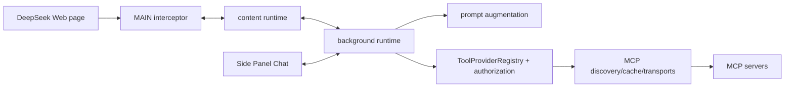

# MCP Capability Plane — Project Overview

## Implemented Direction

DeepSeek++'s MCP has been upgraded from "injecting all tool schemas every turn" to a budget-controlled Capability Plane: commonly used tools can be exposed directly, while long-tail tools are searched, described, and invoked on demand through capability handles issued by the background, without weakening the authorization, audit, or execution boundaries of the real tools.

## Confirmed Task Definition

Scope is limited to MCP tool prompt projection, capability handles, unified authorized execution, Side Panel/automation/inline-agent integration, and MCP settings entry points on desktop Chrome, Edge, and Firefox. The implementation does not bundle a third-party dynamic-mcp service and adds no mobile paths.

## Current Architecture

The MCP cache holds the full `ToolDescriptor`, and before execution it rediscovers the service and verifies it through the descriptor security snapshot. `ToolProviderRegistry` is the sole entry point for provider aggregation and provider-first routing; `core/tool/authorization.ts` holds receiver-owned grants, descriptor snapshots, and one-time call reservations. This implementation consolidates the prompt selection of the four chat/execution surfaces into the same projection service: full descriptors stay on the extension side only, and the model sees only direct projections or restricted discover/describe/invoke helpers.

## Technology Stack

| Layer | Current | Implemented change |
|:--|:--|:--|
| Language | TypeScript / ESM | Keep |
| Extension | WXT MV3 | Keep PC browser scope |
| UI | React 19 / Side Panel | Per-server visible/adaptive/on-demand and adaptive prompt budget controls |
| Persistence | `chrome.storage.local` / IndexedDB | Independent, strictly versioned capability settings and session-scoped lease state |
| Tool runtime | `ToolDescriptor`, authorization, provider registry | Single real target resolver, supporting both direct and opaque-handle projections |
| MCP | HTTP/SSE/Streamable HTTP/bridge/native | Transport semantics unchanged; the Catalog is built on already-discovered descriptors |

## Entry Points

| Entry | Relevant responsibility |
|:--|:--|
| `entrypoints/content.ts` | Manual chat prompt authorization, tool execution, inline agent initiation |
| `entrypoints/background.ts` | runtime composition, Side Panel prompt, automation prompt/execute |
| `entrypoints/background/tool-provider-composition.ts` | Composition root of real MCP and local tool providers |
| `entrypoints/background/tool-execution-handlers.ts` | content/background authorization bridge |
| `entrypoints/background/chat-runtime-service.ts` | Side Panel/Web/API tool continuation loop |
| `core/mcp/*` | Server config, discovery, cache, real MCP execution |
| `core/tool/*` | descriptor, provider registry, authorization, runtime/history |
| `core/prompt/augmentation.ts` | Model-visible rendering of tool schemas |

## Build & Run

| Purpose | Command |
|:--|:--|
| Targeted tests | `npx vitest run <files>` with 60-second process timeout |
| TypeScript | `npm run compile` |
| Prompt contract | `npm run prompt:freeze` |
| MCP smoke | `npm run smoke:mcp` and `npm run verify:mcp:mock` |
| Cross-browser build | `npm run build:all` |
| Closure | `npm run ci:quality` |

## Testing Baseline

The new projection, lease, and runtime suites cover adaptive ordering/budget, handle issuance and one-time consumption, target identity rejection, and the four runtime surfaces; the regression surfaces for MCP execution policy, persistence, authorization, provider routing, runtime handler, request augmentation, Side Panel, inline-agent, and automation are retained. The final `npm run ci:quality` was all green.

## Project Governance Baseline

| Surface | Resolution |
|:--|:--|
| Shared instructions | Root `AGENTS.md` is sole truth |
| Root `CLAUDE.md` | Forbidden; absent |
| Native memory | Available outside repository |
| Repo-local memory | Forbidden |
| Previous active docs | Archived to `docs/archives/pc-runtime-hardening-wave-2/` before this run |
| Tracking | `LOCAL_ONLY`; GitHub pre-flight found `GITHUB_STANDARD`, but no new public planning Issues are created without separate authorization |

## External Integrations

- MCP servers via HTTP, SSE, Streamable HTTP, bridge and native messaging;
- DeepSeek page and official API chat continuations;
- browser runtime messages between content, background and Side Panel.
