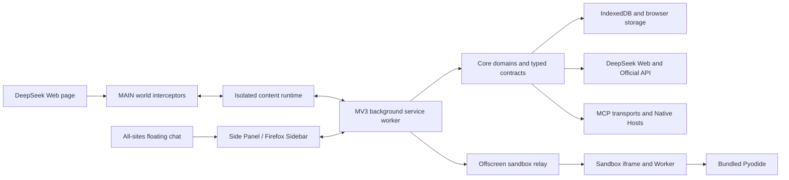

# DeepSeek++ PC Runtime Hardening Wave 2 — Project Overview

## Preliminary Direction

Building on the completed reliability and compatibility refactor from the previous round, continue to address the runtime, compatibility, and performance gaps in the PC Chrome, Edge, and Firefox extensions that still have clear evidence. Android, mobile WebView, mobile packages, and mobile release paths remain permanently excluded; this round keeps the existing prompt, tool XML, storage, messaging, MCP, Native Host, and user-visible legitimate behavior unchanged, and uses multiple acceptance Issues that feed into one batch branch and one final PR.

## Confirmed Task Definition

The user explicitly authorized continued development and asked to avoid the inefficient serial flow of one Issue per PR. After Phase 1, per this authorization and the established PC-only constraint, this round is confirmed as **PC Runtime Hardening Wave 2**:

1. **Scope**: First close the MCP, platform capability, Shell contract, request/tool-stream, and Side Panel first-chat gaps that already have fixtures, failure semantics, or budget evidence; also correct live compatibility gap ownership.
2. **Deferred**: Full Content/Background split, full `core/types.ts` migration, a large Skill importer rewrite, and a complete browser E2E platform are not included in the first batch.
3. **Compatibility**: Legitimate prompt, tool XML, runtime/bridge/MCP/Native wire, storage/IndexedDB/sync, and Chrome/Edge/Firefox user behavior stay unchanged; only malformed/current-gap paths are changed into explicit, testable failures.
4. **Performance**: Only optimize the Side Panel first-chat path that has build evidence; measure first, then lower the budget, and do not substitute mobile limits for optimization.
5. **Testing**: Add automated tests for every behavior change; finally pass, in order, targeted tests, compile, prompt freeze (when affected), three-browser build, manifest/UTF-8, and `ci:quality`.
6. **Delivery**: Use multiple GitHub Issues as the acceptance checklist, all feeding into the current `codex/pc-runtime-hardening-wave-2` integration branch and one final PR; each Issue records its telemetry separately before merge.
7. **Governance**: `AGENTS.md` is the single repo instruction truth; use the platform's native memory, do not create repo-local memory; the previous round's archive stays read-only.

## Continuity Result

- Baseline: `origin/main` / `450b5e2e8e2e61a73417c26840ef9d0224418eb6`.
- Previous round record: [`docs/archives/deepseek-pp-reliability-compatibility-refactor/progress/MASTER.md`](../archives/deepseek-pp-reliability-compatibility-refactor/progress/MASTER.md); status is complete and archived, PR #394 merged.
- Live GitHub status: there are no unfinished `spec-driven` Issues; therefore this round is a new run and does not modify the previous round's archive.
- Way of working: the original `/Users/zcl/code/deepseek-pp` working tree has uncommitted user changes, so this round works in an isolated branch at `/Users/zcl/code/deepseek-pp-worktrees/pc-runtime-hardening-wave-2`.
- Tracking pre-flight: `GITHUB_STANDARD`; Issues, Milestones, and PRs are available; the GitHub Project board is unavailable / not used.

## Current Architecture

The previous round established a typed background registry, a Content lifecycle/resource kernel, a Side Panel typed client, a Shell provider/router layering, a strict persistence recovery protocol, and bundle-size and hot-path budgets. The current architecture has no TypeScript relative-import SCC, but there are still three clear propagation centers: `entrypoints/content.ts` at 7,417 lines, `entrypoints/background.ts` at 1,411 lines, and the high fan-in type bucket in `core/types.ts`.

## Technology Stack

| Layer | Current | Wave-2 position |
|:--|:--|:--|
| Language | TypeScript 5.9 / ESM | Keep |
| Extension framework | WXT 0.20 / MV3 | Keep |
| UI | React 19 / Tailwind CSS 4 | Keep; on-demand loading or controller consolidation based on evidence |
| Persistence | Dexie / IndexedDB / browser storage | Identity and schema remain unchanged |
| Runtime integration | MAIN/content bridge, runtime messaging, MCP, Native Messaging | Receiving boundaries must be strict, single, and testable |
| Sandbox | Offscreen, iframe, Worker, Pyodide | Keep PC browser degradation semantics |
| Tests | Vitest 4 / jsdom / fake IndexedDB / smoke scripts | Strengthen narrow real-browser evidence; do not build an unbounded large E2E platform |
| Build and release | npm workspaces, WXT, GitHub Actions | Keep Chrome/Edge/Firefox builds and package verification |

## Entry Points

| Entry point | Responsibility | Current signal |
|:--|:--|:--|
| `entrypoints/main-world.content.ts` | MAIN bridge, navigation, and interceptor composition | 89 lines; one-sided restart/re-handshake is already tested |
| `entrypoints/content.ts` | DeepSeek DOM, tools, inline agent, theme, pet, export, multimodal composition | 7,417 lines; resource lifecycle already has an owner, but feature state is still concentrated |
| `entrypoints/background.ts` | Sole runtime listener, handler composition, service-worker lifecycle | 1,411 lines; commands are all typed, but cold-start fan-out is still high |
| `entrypoints/sidepanel/` | React surfaces and typed controllers | 60 TS/TSX files, 13,390 lines; the first Chat screen is near the existing budget ceiling |
| `entrypoints/floating-chat.content.ts` | `<all_urls>` launcher composition | Still has content-script startup cost when disabled |
| `entrypoints/sandbox-offscreen/` / `sandbox-runner/` | Chromium offscreen relay and execution Worker | Multi-layer boundaries still need to stay consistent |
| `packages/shell-host/native/` | Native framing, MCP router, providers | Providers are split; source-of-truth drift remains between server version and catalog |

## Build and Run

| Purpose | Command |
|:--|:--|
| Prepare generated types | `npm run postinstall` |
| Targeted tests | `vitest run <files>`, with a 60-second hard timeout |
| TypeScript | `npm run compile` |
| Prompt compatibility | `npm run prompt:freeze` |
| Browser builds | `npm run build:all` |
| Manifest and encoding | `npm run verify:manifest-policy`; `npm run verify:extension-utf8` |
| Full closure | `npm run ci:quality` |

## Testing Baseline

- After reusing dependencies from the completed owner lane, first run `npm run postinstall` to generate the worktree-local `.wxt/tsconfig.json`.
- The candidate-gap test baseline at the current HEAD passes: 6 files / 47 tests (request augmentation, DeepSeek protocol, streaming tool parser/text, platform contract, Shell external contract).
- `npm run compile` passes.
- Previous round's full `ci:quality`: 161 test files / 1,166 tests, three-browser build/zip/package, prompt freeze, MCP/Shell/PoW, manifest/UTF-8, and offline Pyodide all passed.
- There is still no real Chrome lifecycle smoke that proves the unpacked extension actually loads; the previous round's Chrome 150 command-line load failed, so it was not recorded as a pass.

## Pre-implementation Findings (closed by PR #402)

The five issues raised by the previous round's read-only audit were fixed in `450b5e2` and must not be re-filed: MAIN/content one-sided restart, Settings `GET_CONFIG` decoding, duplicated Side Panel runtime failure implementation, PET load/event race, and broad swallowing of errors in auth refresh.

The items below are a snapshot of candidate gaps with direct evidence before PR #402 merged; all were closed in that PR and the final `ci:quality`. They are kept only as pre-implementation evidence and are not current TODOs. Current status is per [`docs/progress/MASTER.md`](../progress/MASTER.md).

1. MCP JSON-RPC response intake still normalizes wrong versions/wrong IDs/`result + error`; tool output is truncated by UTF-16 characters; pagination can exceed `maxToolCount`.
2. The platform fixture still freezes three expired gaps: probing a capability without declaring the `downloads` permission, sync identity having no consumer-owned capability, and Shell optimistically judged supported when the environment is not loaded.
3. The browser and Native tool catalogs still have a double-write surface; the Shell Native router's version reporting has converged on npm package metadata and is no longer fixed at `1.0.0`.
4. DeepSeek request augmentation has no single strict decoder for legal JSON with a non-object/non-string prompt; the ordering of parsing and authorization can still be tightened.
5. When a streaming tool call is unclosed at EOF, the parser state is cleared and the already-emitted `started` event has no explicit terminal state.
6. The Side Panel's first Chat screen has less than 1% of raw/gzip budget headroom left.
7. Live compatibility fixtures still point several gaps at the already-closed old R4/R5 Issues, so governance records are inconsistent with actual status.

## Project Governance Baseline

| Surface | Resolution |
|:--|:--|
| Root `AGENTS.md` | Sole project-level instruction truth source |
| Root `CLAUDE.md` | Does not exist and must not be created |
| Nested video instructions | Apply only to `videos/deepseek-pp-promo/`; not touched in this round |
| Native project memory | May be used for cross-session workflow context; repo-local Markdown is not used as a memory fallback |
| Repo-local memory | Explicitly forbidden |
| Active spec docs | `docs/analysis/` is newly created in this round; the previous round's archive stays read-only |

## External Integrations

- DeepSeek Web/Official API: `core/deepseek/`, `core/interceptor/`
- MCP: HTTP, SSE, Streamable HTTP, bridge, and Native transports in `core/mcp/`
- Shell Native Host: `packages/shell-host/`
- Sync: WebDAV, Google Drive, OneDrive, in `core/sync/`
- Browser Control: Chrome Debugger Protocol, in `core/browser-control/`
- Sandbox/Pyodide: `core/sandbox/` and sandbox entrypoints
