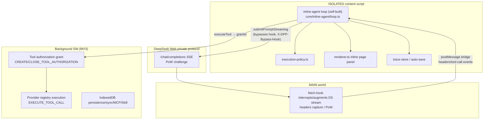

# Project Overview — pi-agent-core Integration

## Preliminary Direction

Embed the open-source `@earendil-works/pi-agent-core@0.83.0` (MIT) as the loop engine of the DeepSeek++ inline agent, wrapping the DeepSeek web interface as the model backend through a custom StreamFn to run the Agent inline within the DS chat page; replace the existing self-built inline-agent loop (`core/inline-agent/loop.ts`) while keeping the execution policy, authorization path, and rendering layer. Goals: stronger loop capabilities (compaction/retry/parallel tools), lower self-maintenance, an extended tool ecosystem, and reuse of pi's agents/skills configuration.

## Current Architecture

**Key facts**:
- The inline agent runs entirely in the ISOLATED content context; the model backend is `submitPromptStreaming` in `core/deepseek/active-client.ts` (content connects directly to the DS Web API, using headers captured in the MAIN world + local PoW WASM solving, bypassing the hook).
- Tool execution goes via `chrome.runtime.sendMessage(EXECUTE_TOOL_CALL + authorizationId)` → background authorization (grant bound to capabilityScope/requestId/one-time reservation) and is then executed by the provider.
- Limits of the current self-built loop: MAX_STEPS=25, MAX_NUDGES=8, STEP_TIMEOUT=120s, 2.5–6.5s delay between steps, 12k stream event truncation.

## Technology Stack

| Layer | Current | Target |
|:------|:--------|:-------|
| Language | TypeScript | TypeScript (unchanged) |
| Framework | WXT + React (sidepanel) + vanilla content | Unchanged |
| Agent loop | Self-built `core/inline-agent/loop.ts` | `@earendil-works/pi-agent-core@0.83.0` (exact pin) |
| LLM provider | Self-built `active-client.submitPromptStreaming` | Custom StreamFn thin adapter (reusing active-client) |
| Build | WXT/Vite (`build:all` three browsers) | Unchanged; narrow-entry imports + tree-shake verification required |
| Tests | Vitest (197 test files) + golden fixtures | Unchanged; new loop event protocol golden added |
| Persistence | IndexedDB (memory v30, etc.) | Unchanged (pi context not persisted) |

## Entry Points

- `entrypoints/background.ts` — background SW composition root (authorization, execution, persistence, MCP, automation)
- `entrypoints/content.ts` — ISOLATED content (7793 lines): DOM capability aggregation, inline agent host, `startInlineAgentLoop`
- `entrypoints/main-world.content.ts` — MAIN world: fetch-hook, headers/PoW, streaming tool call parsing
- `entrypoints/sidepanel/*`, `floating-chat.content.ts`, `sandbox-offscreen/*`, `sandbox-runner/*`

## Build & Run

- Build: `npm run build:all` (chrome/edge/firefox); `zip:all` produces packages
- Tests: `npm test` (vitest run, hard 60s timeout)
- Static: `npm run compile` (tsc --noEmit)
- Verification chain: `prompt:freeze` → `compile` → `test` → `verify:*` → `smoke:*` → `build:all` → `ci:quality` (21-segment master gate, CI single job 30min)
- Size red line: background raw ≤ 820,000 / gzip ≤ 240,000; currently 633K/181K (headroom ≈187K/59K); content.js 562K/159K (no separate red line, but affects page load)

## Testing Baseline

- Surfaces: inline-agent (loop/prompt/policy/renderer), tool-authorization (909 lines), deepseek stream/protocol/official-api, interceptor (fetch-hook/augmentation/tool-parser/history-cleanup), compat fixtures (prompt-output golden ×4, external-runtime, persistence-contract ×10, runtime-contract)
- Key mechanism: `prompt-output-contract.test.ts` directly imports production functions to verify golden; authorization tests use the real provider chain (`tests/helpers/production-tool-runtime.ts`)
- **Gap**: The AGENT_* loop event sequence + payloads have no contract test (only behavior tests) — must be added before replacing the loop

## Project Governance Baseline

- Shared instruction surface: `AGENTS.md` (sole project-level source of truth; root `CLAUDE.md` forbidden)
- Memory surface: Codex native memory; no in-repo memory files
- Compatibility registry: `docs/compatibility/README.md` (prompt-and-runtime / persistence-and-sync / platform-and-integrations), row structure of 7 fields + 7 change protocol rules
- Historical archive: `docs/archives/` (the mcp-capability-plane archive was completed before this run; the docs/ namespace is free)

## External Integrations

- DeepSeek Web private protocol (9 routes, SSE `{p,o,v}` patches, PoW, 4MiB budget) — sole authority `core/deepseek/stream-codec.ts`
- DeepSeek Official API (OpenAI-compatible + reasoning_content)
- MCP (HTTP/SSE/Streamable), Native Host (shell), browser control (CDP), sandbox (offscreen + Pyodide)
- Target additions: `@earendil-works/pi-agent-core@0.83.0` + `@earendil-works/pi-ai@^0.83.0` (narrow entries only, avoiding dragging in the AWS/Anthropic and other SDK dependency trees)
