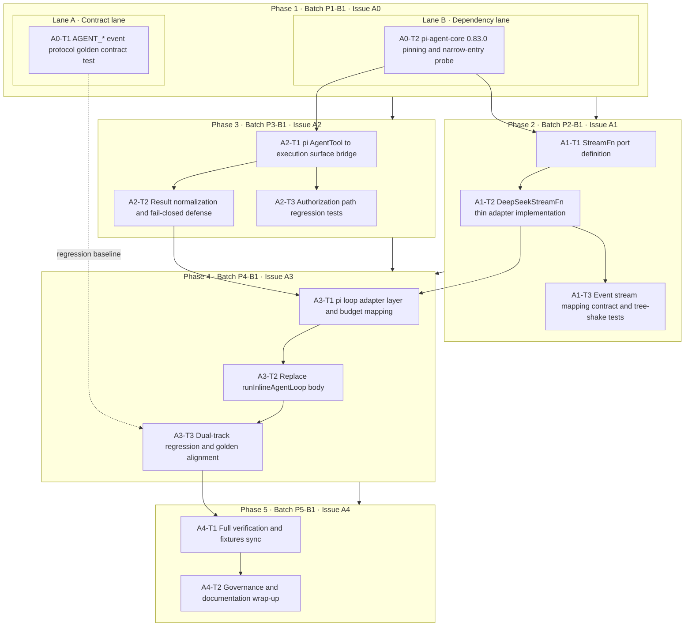

# Task Dependency Graph — pi-agent-core Integration Step A

Notes:
- A0-T1 and A0-T2 have no solid-line dependency (parallel lanes); dashed lines are "baseline/verification" relationships (golden is the reference baseline for A3-T3).
- Subgraphs are batch boundaries; solid lines between batches = PR merge order (the next batch starts only after the previous batch merges).
- A3 is strictly sequential internally (single-file replacement of loop.ts, no parallelism).
